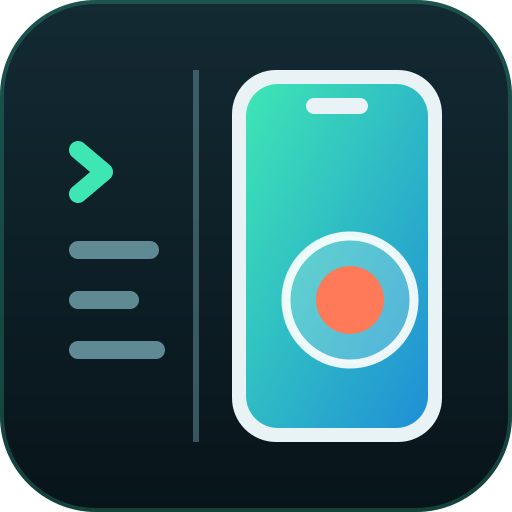

<p align="center">
  
</p>

<h1 align="center">simpane</h1>

<p align="center">
  <em>Your phone simulator, live in Claude Code.</em>
</p>

<p align="center">
  
  
  
  
</p>

---

A Claude Code mod that shows an iPhone simulator or Android emulator screen live in a side pane. You can tap, swipe and type on it while your agent builds and tests the app.

## Install

```text
claude plugin marketplace add XyndoX/simpane
claude plugin install simpane@simpane --scope user
```

Or from inside Claude Code: `/plugin marketplace add XyndoX/simpane`, then `/plugin install simpane@simpane`. Then:

```
/simpane            # whatever is running, iPhone first
/simpane android
```

## Use

| You do | The device gets |
|---|---|
| click | tap |
| drag | swipe |
| mouse wheel | scroll |
| click the pane, then type | text (letters are sent together) |
| return / backspace / tab / arrows | the same key |
| esc, ⌂ | home |
| ◁ ▢ (Android) | back, app switcher |

If nothing is running, the pane lists your simulators or AVDs. Click one to boot it headless, so it shows up only in the pane.

## Needs

- A terminal that draws pictures: Ghostty, cmux or kitty. tmux does not.
- **iPhone:** Xcode, plus [AXe](https://github.com/cameroncooke/AXe) for input and fast frames: `brew install cameroncooke/axe/axe`. Without AXe the screen still mirrors (via `xcrun simctl`, about 1 frame a second), but it takes no input. idb's input does not work with Xcode 27.
- **Android:** `adb` and `emulator` on the PATH or in `~/Library/Android/sdk`, for example from Android Studio's Device Manager or `brew install --cask android-commandlinetools`. Android support is written but not yet tested on a real emulator — reports welcome.

## Letting the agent test

The agent drives the same device from Bash, and you watch it happen in the pane:

```sh
axe describe-ui --udid <udid>                 # the accessibility tree: what's on screen and where
axe tap --label "Sign in" --udid <udid>       # tap by label or id
axe type "hello" --udid <udid>
axe screenshot --udid <udid> --output s.png   # then read the image
adb shell input tap 500 1200                  # Android
adb exec-out screencap -p > s.png
```

`xcrun simctl list devices booted` gives the udid.

## How it works

About five times a second the device writes a PNG, using `axe screenshot` or `adb exec-out screencap -p`, into one of two temp files in turn. The mod swaps the pane's picture with `$.ui.blit`, and the terminal reads the file itself, so no pixels go through Claude Code. Clicks land on an empty overlay that reports where the press started and ended as fractions of the screen. The mod turns those into device points (pixels on Android).

## License

MIT
